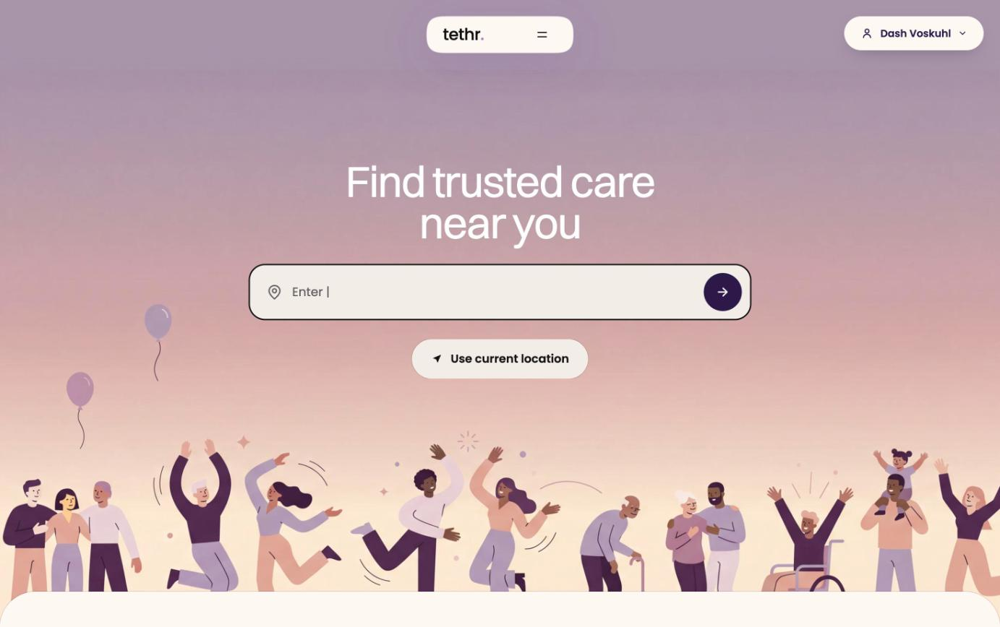
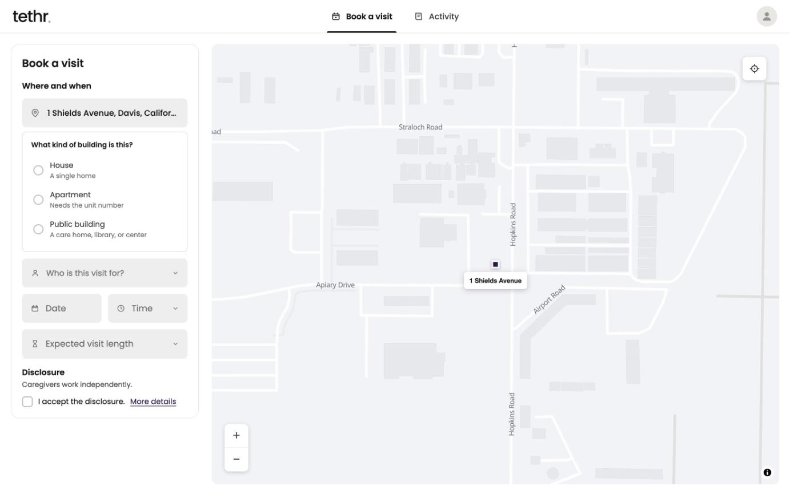

# Tethr

Web app for booking a caregiver like a ride. A family enters an address, date, time and visit length. A nearby caregiver accepts or declines.

- **Role:** cofounder and CEO. Spec, UI design, build, deploy.
- **Build:** Claude Code, 13 days (Aug 26 to Sep 7, 2026), 204 commits.
- **Pilot:** private, invite only, families from our waitlist.
- **Status:** left in November 2026. Now building [Nascoron](https://nascoron.com).

## Why

Agencies told me same day care isn't how their industry works. Goal: book a caregiver in minutes.

## Stack

- Next.js on Cloudflare Workers
- Supabase: auth and database
- Family app: address search, live map, booking, request status
- Caregiver app: availability, accept or decline
- Operator console: live visitors, charts
- Pre-launch security pass: authorization, CSRF, credentials, rate limits

## Code

Private. The app stored family addresses.
